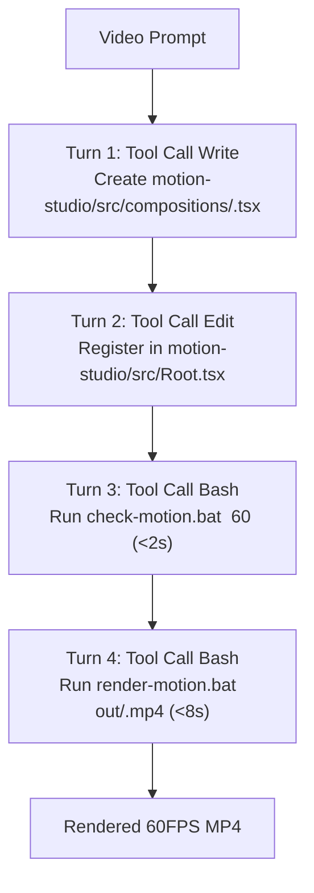

# 🎬 Remotion Motion Graphics Master Skill

Create high-end, 60fps cinematic motion graphics, explainer videos, dynamic data visualizations, and procedural animations in a **single autonomous shot** using Remotion and React.

---

## ⚡ The 1-Shot Execution Contract (MANDATORY)

When a motion graphics or video prompt is received, **NEVER waste turns reading files or outputting conversational pauses**.

### The Stalling Anti-Pattern (PROHIBITED)
❌ Reading 9-11 files in `motion-studio/src/library/` to inspect props or types.
❌ Outputting conversational text ("*Now I have a clear understanding of the existing structure. Let me create...*") and stopping without writing code.
❌ Emitting unmounted canvas scripts or non-deterministic timers (`setInterval`, `Date.now()`).

### The 1-Shot Autonomous Pipeline (ENFORCED)
All library components, props, springs, easing functions, and palettes are **100% pre-cached in this skill document**. You already know all signatures. Proceed immediately through these deterministic turns:



- **Turn 1**: Call `Write` to create `motion-studio/src/compositions/<Name>.tsx` using the pre-cached catalog below. Zero comments before calling the tool.
- **Turn 2**: Call `Edit` to register the composition in `motion-studio/src/Root.tsx`.
- **Turn 3**: Call `Bash` to run `check-motion.bat <Name> 60` (validates TypeScript + renders frame 60 still PNG in <2s).
- **Turn 4**: Call `Bash` to run `render-motion.bat <Name> out/<name>.mp4` (multithreaded 12-core ANGLE GPU render in <8s).

---

## 📦 Pre-Cached API Catalog (`motion-studio/src/library`)

Import path from any composition in `motion-studio/src/compositions/`:
```tsx
import {
  springPresets,
  getSpringValue,
  interpolateSafe,
  clamp,
  getInOutOpacity,
  slideIn,
  palettes,
  KineticTitle,
  GlowBadge,
  ParticleField,
  OrbitalRings,
  VignetteOverlay,
  GridBackdrop,
  LightSweep,
  GlowDefs,
  CameraRig,
} from "../library";
```

### 1. Spring Physics (`../library/springs`)

Pre-calibrated spring physics configurations for fluid 60FPS motion with controlled overshoot:

| Preset | Damping | Mass | Stiffness | Settling Time (60fps) | Best For |
|---|---|---|---|---|---|
| `snappy` | 15 | 0.5 | 180 | ~15–20 frames | Badges, pop-in UI, icons, micro-interactions |
| `bouncy` | 10 | 0.8 | 120 | ~30–40 frames | Kinetic titles, elastic cards, callout badges |
| `smooth` | 18 | 1.0 | 90 | ~35–45 frames | Scene transitions, slides, standard UI (Apple-grade) |
| `cinematic` | 24 | 2.2 | 55 | ~60–80 frames | Hero logo reveals, camera pushes, heavy title drops |
| `gentle` | 22 | 1.4 | 65 | ~50–65 frames | Floating UI, subtle ambient breathing |
| `slowMo` | 30 | 3.0 | 40 | ~90–120 frames | Dreamy slow-motion, space floats |

```tsx
// Signature:
export function getSpringValue(
  frame: number,
  fps: number,
  preset?: "snappy" | "bouncy" | "smooth" | "cinematic" | "gentle" | "slowMo",
  delayFrames?: number
): number;

// Usage:
const entrance = getSpringValue(frame, fps, "bouncy", 10); // Starts at frame 10, yields 0 -> ~1.05 -> 1.0
```

### 2. Clamped Interpolation & Timing Math (`../library/interpolations`)

Guaranteed safe bounds (`extrapolateLeft: "clamp"`, `extrapolateRight: "clamp"`) preventing visual blowouts:

```tsx
// Clamped interpolation:
export function interpolateSafe(
  frame: number,
  inputRange: readonly number[],
  outputRange: readonly number[],
  easing?: (input: number) => number
): number;

// Basic clamp:
export function clamp(value: number, min: number, max: number): number;

// Entrance + Exit opacity fade (0 -> 1 -> 1 -> 0):
export function getInOutOpacity(
  frame: number,
  totalFrames: number,
  fadeFrames?: number // Default: 20
): number;

// Linear slide from px to px:
export function slideIn(
  frame: number,
  startFrame: number,
  durationFrames: number,
  fromPx: number,
  toPx?: number, // Default: 0
  easing?: (t: number) => number
): number;
```

### 3. Curated Color Palettes (`../library/palettes`)

```tsx
export const palettes = {
  appleMinimal: {
    background: "#0b0c10",
    surface: "#1a1c23",
    textPrimary: "#f5f5f7",
    textSecondary: "#86868b",
    accent: "#ff9f0a",
    accentSecondary: "#ff375f",
    glow: "rgba(255, 159, 10, 0.35)",
  },
  cyberpunk: {
    background: "#05060b",
    surface: "#0e111d",
    textPrimary: "#ffffff",
    textSecondary: "#6a7b9b",
    accent: "#00f0ff",
    accentSecondary: "#ff007f",
    glow: "rgba(0, 240, 255, 0.45)",
    glowSecondary: "rgba(255, 0, 127, 0.4)",
  },
  deepSpace: {
    background: "#03050d",
    surface: "#0c1022",
    textPrimary: "#eaf2ff",
    textSecondary: "#7280a5",
    accent: "#7928ca",
    accentSecondary: "#0070f3",
    glow: "rgba(121, 40, 202, 0.4)",
  },
  solarEarth: {
    background: "#030712",
    surface: "#0f172a",
    textPrimary: "#f8fafc",
    textSecondary: "#94a3b8",
    ocean: "#0284c7",
    continent: "#10b981",
    atmosphere: "#38bdf8",
    glow: "rgba(56, 189, 248, 0.35)",
  },
  darkLuxury: {
    background: "#0a0a0c",
    surface: "#18181b",
    textPrimary: "#fafafa",
    textSecondary: "#a1a1aa",
    accent: "#d4af37",
    accentSecondary: "#a3704c",
    glow: "rgba(212, 175, 55, 0.3)",
  },
};
```

### 4. Kinetic Typography & Badges (`../library/typography`)

```tsx
// Kinetic Title: Per-word spring entrance with glow & zero layout shift
<KineticTitle
  text="REVOLUTIONIZING MOTION"
  preset="bouncy"          // "snappy" | "bouncy" | "smooth" | "cinematic"
  staggerFrames={3}        // Frames between each word reveal
  startFrame={15}          // Frame when animation begins
  fontSize={72}            // Font size in px
  fontWeight={800}         // Weight
  color="#ffffff"          // Text fill
  glowColor="#00f0ff"      // Drop-shadow glow color
  letterSpacing={-1}       // Spacing in px
  style={{ margin: "20px 0" }}
/>

// Glow Badge: Glassmorphic pill badge with live neon indicator
<GlowBadge
  label="NEURAL CORE ACTIVE"
  accentColor="#00f0ff"
  backgroundColor="rgba(255, 255, 255, 0.06)"
  textColor="#ffffff"
  startFrame={5}
/>
```

### 5. Particles & Orbital Rings (`../library/particles`)

100% deterministic (Mulberry32 seed-locked), zero frame-to-frame jumpiness or flickering:

```tsx
// Deterministic Particle Floating Field:
<ParticleField
  count={60}              // Number of particles
  color="#00f0ff"          // Particle color
  speed={1.2}              // Speed multiplier
  maxRadius={3.5}          // Maximum particle radius in px
  driftRange={50}          // Max trigonometric drift in px
/>

// 3D Tilted Orbital Rings:
<OrbitalRings
  cx={960}                 // Center X in px
  cy={540}                 // Center Y in px
  radius={240}             // Base orbit radius
  ringCount={4}            // Number of concentric rings
  primaryColor="#00f0ff"   // Outer/even ring color
  accentColor="#ff007f"    // Inner/odd ring color
  rotationSpeed={0.6}      // Speed factor
  tiltAngle={65}           // 3D perspective tilt in degrees
/>
```

### 6. Atmospheric Effects (`../library/effects`)

```tsx
// Cinematic Vignette Overlay (darkens edges to guide eye):
<VignetteOverlay intensity={0.75} color="#000000" />

// Sci-Fi Tech Grid Backdrop:
<GridBackdrop gridSize={60} strokeColor="rgba(255, 255, 255, 0.08)" opacity={0.5} />

// Specular Light Sweep / Screen Flare:
<LightSweep startFrame={20} durationFrames={45} color="rgba(0, 240, 255, 0.3)" angle={35} />

// SVG Glow Defs:
<GlowDefs id="neonGlow" blurStdDev={10} />
```

### 7. 2.5D Camera Rig (`../library/camera`)

Smooth cinematic camera push/pull and panning across scenes:

```tsx
<CameraRig
  startZoom={1.0}
  endZoom={1.08}
  startPanX={0}
  endPanX={-30}
  startPanY={0}
  endPanY={-15}
  startFrame={0}
  durationFrames={600}
>
  {/* Scene contents */}
</CameraRig>
```

---

## 🏛️ The 5-Scene Modular `<Series>` Architecture

For any multi-scene or explainer video (15s to 60s, scalable to 1 hour), **never build a monolithic 500-line single scene**. Use Remotion's `<Series>` with modular sub-scenes. This guarantees:
1. Flat memory usage (<150MB V8 heap).
2. Clean separation of concerns.
3. Easy duration tuning and reordering.

### Standard 60-Second Explainer Blueprint (3,600 Frames @ 60fps)

```tsx
import React from "react";
import { AbsoluteFill, Series, useCurrentFrame, useVideoConfig } from "remotion";
import {
  springPresets,
  getSpringValue,
  interpolateSafe,
  palettes,
  KineticTitle,
  GlowBadge,
  ParticleField,
  OrbitalRings,
  VignetteOverlay,
  GridBackdrop,
  CameraRig,
} from "../library";

// ==========================================
// SCENE 1: THE HOOK & TITLE REVEAL (0s - 10s = 600 frames)
// ==========================================
const Scene01_Hook: React.FC = () => {
  const frame = useCurrentFrame();
  const { fps } = useVideoConfig();
  const p = palettes.cyberpunk;

  return (
    <AbsoluteFill style={{ backgroundColor: p.background }}>
      <GridBackdrop gridSize={80} opacity={0.3} />
      <ParticleField count={40} color={p.accent} speed={0.8} />
      <CameraRig startZoom={1.0} endZoom={1.05} durationFrames={600}>
        <div style={{ display: "flex", flexDirection: "column", alignItems: "center", justifyContent: "center", height: "100%" }}>
          <GlowBadge label="NEXT-GEN INTELLIGENCE" accentColor={p.accent} startFrame={15} />
          <div style={{ height: 24 }} />
          <KineticTitle text="AUTONOMOUS REASONING ENGINE" preset="bouncy" startFrame={35} fontSize={68} color={p.textPrimary} glowColor={p.accent} />
          <p style={{
            fontSize: 24,
            color: p.textSecondary,
            letterSpacing: 4,
            opacity: interpolateSafe(frame, [60, 90], [0, 1]),
            transform: `translateY(${interpolateSafe(frame, [60, 90], [20, 0])}px)`,
          }}>
            NVIDIA NEMOTRON ULTRA 550B • 60FPS SYNTHESIS
          </p>
        </div>
      </CameraRig>
      <VignetteOverlay intensity={0.7} />
    </AbsoluteFill>
  );
};

// ==========================================
// SCENE 2: THE PROBLEM / BOTTLENECK (10s - 25s = 900 frames)
// ==========================================
const Scene02_Challenge: React.FC = () => {
  const frame = useCurrentFrame();
  const { fps } = useVideoConfig();
  const p = palettes.cyberpunk;

  return (
    <AbsoluteFill style={{ backgroundColor: p.background }}>
      <GridBackdrop gridSize={60} opacity={0.2} />
      <CameraRig startZoom={1.02} endZoom={1.08} durationFrames={900}>
        <div style={{ display: "flex", flexDirection: "column", alignItems: "center", justifyContent: "center", height: "100%" }}>
          <GlowBadge label="THE ARCHITECTURAL BOTTLENECK" accentColor={p.accentSecondary} startFrame={10} />
          <div style={{ height: 24 }} />
          <KineticTitle text="LEGACY MULTI-TURN EXPLORATION" preset="smooth" startFrame={25} fontSize={56} color={p.textPrimary} />
          <div style={{ display: "flex", gap: 32, marginTop: 40 }}>
            {["11 File Reads", "Context Saturation", "Agent Halting"].map((item, idx) => {
              const cardProgress = getSpringValue(frame, fps, "snappy", 60 + idx * 20);
              return (
                <div key={idx} style={{
                  padding: "24px 36px",
                  borderRadius: 16,
                  background: p.surface,
                  border: `1px solid ${p.accentSecondary}44`,
                  transform: `scale(${cardProgress}) translateY(${interpolateSafe(cardProgress, [0, 1], [30, 0])}px)`,
                  opacity: cardProgress,
                }}>
                  <div style={{ fontSize: 28, fontWeight: 700, color: p.accentSecondary }}>0{idx + 1}</div>
                  <div style={{ fontSize: 20, color: p.textPrimary, marginTop: 8 }}>{item}</div>
                </div>
              );
            })}
          </div>
        </div>
      </CameraRig>
      <VignetteOverlay intensity={0.8} />
    </AbsoluteFill>
  );
};

// ==========================================
// SCENE 3: THE SOLUTION / 1-SHOT ARCHITECTURE (25s - 40s = 900 frames)
// ==========================================
const Scene03_Solution: React.FC = () => {
  const frame = useCurrentFrame();
  const { fps } = useVideoConfig();
  const p = palettes.cyberpunk;

  return (
    <AbsoluteFill style={{ backgroundColor: p.background }}>
      <OrbitalRings cx={960} cy={540} radius={220} ringCount={4} primaryColor={p.accent} accentColor={p.accentSecondary} />
      <ParticleField count={50} color={p.accent} speed={1.4} />
      <CameraRig startZoom={1.0} endZoom={1.06} durationFrames={900}>
        <div style={{ display: "flex", flexDirection: "column", alignItems: "center", justifyContent: "center", height: "100%" }}>
          <GlowBadge label="DETERMINISTIC 1-SHOT EXECUTION" accentColor={p.accent} startFrame={10} />
          <div style={{ height: 20 }} />
          <KineticTitle text="PRE-CACHED SKILL INGESTION" preset="bouncy" startFrame={25} fontSize={58} color={p.textPrimary} glowColor={p.accent} />
          <div style={{
            marginTop: 36,
            padding: "20px 40px",
            borderRadius: 12,
            background: "rgba(0, 240, 255, 0.08)",
            border: `1px solid ${p.accent}66`,
            fontSize: 22,
            color: p.accent,
            fontFamily: "monospace",
            opacity: interpolateSafe(frame, [45, 75], [0, 1]),
          }}>
            Turn 1: Write Composition • Turn 2: Register Root • Turn 3: Turbo Render
          </div>
        </div>
      </CameraRig>
      <VignetteOverlay intensity={0.75} />
    </AbsoluteFill>
  );
};

// ==========================================
// SCENE 4: BENCHMARKS & PERFORMANCE (40s - 55s = 900 frames)
// ==========================================
const Scene04_Metrics: React.FC = () => {
  const frame = useCurrentFrame();
  const { fps } = useVideoConfig();
  const p = palettes.cyberpunk;

  const metrics = [
    { label: "EXPLORATION TURNS", val: "0", target: 0, unit: "Turns" },
    { label: "TIME-TO-FIRST-FRAME", val: "<0.5s", target: 0.48, unit: "Seconds" },
    { label: "RENDER THROUGHPUT", val: "60 FPS", target: 60, unit: "Frames/Sec" },
  ];

  return (
    <AbsoluteFill style={{ backgroundColor: p.background }}>
      <GridBackdrop gridSize={50} opacity={0.25} />
      <CameraRig startZoom={1.0} endZoom={1.05} durationFrames={900}>
        <div style={{ display: "flex", flexDirection: "column", alignItems: "center", justifyContent: "center", height: "100%" }}>
          <GlowBadge label="VERIFIED PERFORMANCE" accentColor={p.accent} startFrame={10} />
          <div style={{ height: 24 }} />
          <KineticTitle text="INSTANTANEOUS VELOCITY" preset="snappy" startFrame={20} fontSize={56} color={p.textPrimary} />
          <div style={{ display: "flex", gap: 40, marginTop: 48 }}>
            {metrics.map((m, idx) => {
              const progress = getSpringValue(frame, fps, "bouncy", 40 + idx * 25);
              return (
                <div key={idx} style={{
                  display: "flex",
                  flexDirection: "column",
                  alignItems: "center",
                  padding: "32px 48px",
                  borderRadius: 20,
                  background: p.surface,
                  border: `1px solid ${p.accent}33`,
                  boxShadow: `0 0 30px ${p.accent}15`,
                  transform: `scale(${progress})`,
                  opacity: progress,
                }}>
                  <div style={{ fontSize: 52, fontWeight: 900, color: p.accent }}>{m.val}</div>
                  <div style={{ fontSize: 14, letterSpacing: 2, color: p.textSecondary, marginTop: 12 }}>{m.label}</div>
                </div>
              );
            })}
          </div>
        </div>
      </CameraRig>
      <VignetteOverlay intensity={0.7} />
    </AbsoluteFill>
  );
};

// ==========================================
// SCENE 5: OUTRO & CALL TO ACTION (55s - 60s = 300 frames)
// ==========================================
const Scene05_Outro: React.FC = () => {
  const frame = useCurrentFrame();
  const { fps } = useVideoConfig();
  const p = palettes.cyberpunk;

  const scale = getSpringValue(frame, fps, "cinematic", 10);

  return (
    <AbsoluteFill style={{ backgroundColor: p.background }}>
      <ParticleField count={60} color={p.accent} speed={1.5} />
      <div style={{ display: "flex", flexDirection: "column", alignItems: "center", justifyContent: "center", height: "100%", transform: `scale(${scale})` }}>
        <GlowBadge label="PRODUCTION READY" accentColor={p.accent} startFrame={15} />
        <div style={{ height: 24 }} />
        <KineticTitle text="BUILD AT THE SPEED OF THOUGHT" preset="bouncy" startFrame={30} fontSize={62} color={p.textPrimary} glowColor={p.accent} />
        <p style={{ fontSize: 22, color: p.textSecondary, letterSpacing: 3, marginTop: 20 }}>
          MOTION GRAPHICS • AUTONOMOUS CLI • 60FPS
        </p>
      </div>
      <VignetteOverlay intensity={0.8} />
    </AbsoluteFill>
  );
};

// ==========================================
// MASTER EXPORT: 5-SCENE SERIES
// ==========================================
export const MyCompositionName: React.FC = () => {
  return (
    <Series>
      <Series.Sequence durationInFrames={600}>
        <Scene01_Hook />
      </Series.Sequence>
      <Series.Sequence durationInFrames={900}>
        <Scene02_Challenge />
      </Series.Sequence>
      <Series.Sequence durationInFrames={900}>
        <Scene03_Solution />
      </Series.Sequence>
      <Series.Sequence durationInFrames={900}>
        <Scene04_Metrics />
      </Series.Sequence>
      <Series.Sequence durationInFrames={300}>
        <Scene05_Outro />
      </Series.Sequence>
    </Series>
  );
};
```

---

## ⚙️ Procedural Loops for Long-Form (Up to 1 Hour)

When tasked with generating a long-form video (e.g. 5 minutes, 15 minutes, or 1 hour = 216,000 frames):
- Use procedural modulo arithmetic so memory stays flat (~150MB V8 heap):
  ```tsx
  const cycleLength = 1800; // 30 second loop cycle
  const cycleFrame = frame % cycleLength;
  const loopIndex = Math.floor(frame / cycleLength);
  ```
- Shift palettes or titles deterministically using `loopIndex`.
- Never accumulate objects in memory across frames.

---

## 🛠️ Step 2: Register in `motion-studio/src/Root.tsx`

Every composition must be registered with both standard 1080p and 4K presets:

```tsx
// In motion-studio/src/Root.tsx:
import { MyCompositionName } from "./compositions/MyCompositionName";

// Inside <RemotionRoot>:
<Composition
  id="MyCompositionName"
  component={MyCompositionName}
  durationInFrames={3600}
  fps={60}
  width={1920}
  height={1080}
/>
<Composition
  id="my-composition-name"
  component={MyCompositionName}
  durationInFrames={3600}
  fps={60}
  width={1920}
  height={1080}
/>
<Composition
  id="MyCompositionName-4K"
  component={MyCompositionName}
  durationInFrames={3600}
  fps={60}
  width={3840}
  height={2160}
/>
```

---

## 🚀 Verification & Render Batch Tooling

After saving `motion-studio/src/compositions/<Name>.tsx` and updating `Root.tsx`:

### 1. Fast Check (<2s)
```cmd
check-motion.bat MyCompositionName 60
```
Runs `npx tsc --noEmit` and renders frame 60 still image to `motion-studio/out/_check_MyCompositionName.png`.

### 2. Turbo MP4 Render (<8s)
```cmd
render-motion.bat MyCompositionName out/my-composition.mp4
```
Renders 60FPS video using 12 parallel threads with ANGLE GPU acceleration and Webpack bundle caching.

### 3. 1-Click Autonomous Runner
```cmd
motion.bat MyCompositionName "Explain autonomous agent routing"
```

---

## 🚫 Critical Anti-Patterns & Hard Rules

1. **NEVER call `Glob` or `Read` on `motion-studio/src/library/`**. You have all exports and types documented here.
2. **NEVER pause with conversational promises**. Always emit the `Write` tool call immediately.
3. **NEVER use `Math.random()` in render**. Use the deterministic Mulberry32 generator inside `useMemo` or frame math.
4. **NEVER use browser timers** (`setInterval`, `setTimeout`, `requestAnimationFrame`, `Date.now()`). Remotion uses a virtual frame clock.
5. **NEVER use SVG SMIL animations** (`<animate>`, `<animateTransform>`). Headless Chromium does not advance SMIL time properly in headless still/frame capture.
6. **Always clamp interpolations**: Use `interpolateSafe` or `{ extrapolateLeft: "clamp", extrapolateRight: "clamp" }`.
7. **Always match exports**: Named export `export const Foo` in composition file, named import `import { Foo } from ...` in `Root.tsx`.

---

## 🌟 Community Best Practices (`remotion-dev/claude-code-plugin` & `haidrrrry/claude-remotion-skill`)

### 1. Zero Layout Shift & GPU Acceleration
- **Transform Over Geometry**: Never animate `top`, `left`, `width`, or `height`. Always use GPU-accelerated `transform: translate3d(x, y, 0) scale(s) rotate(deg)` combined with `opacity`.
- **Hardware Layering**: Annotate animated hero elements with `willChange: "transform, opacity"` to force separate compositor layers.
- **Root Sizing**: Enforce container boundaries with `AbsoluteFill` (`position: absolute; inset: 0`) and `overflow: "hidden"` to prevent canvas bleeding.

### 2. Micro-Interaction & Kinetic Typography Choreography
- **Optical Focus**: Combine spring translation with dynamic `filter: blur(...)` to simulate high-speed cinema camera depth of field.
- **Tokenized Staggering**: Break sentences into words or characters, applying `(startFrame + index * staggerDelay)` to create smooth cascading ripple entrances.
- **Settling Envelope**: Use `springPresets.snappy` for badges/pills (settles in 15f), `springPresets.bouncy` for kinetic titles (settles in 30f), and `springPresets.cinematic` for camera movements (settles in 60f).

### 3. Visual Staging Hierarchy (The 5-Layer Stack)
Every cinematic Remotion composition should strictly follow the 5-layer visual hierarchy:
1. **Layer 0 (Atmosphere)**: Radial gradient backdrops, SVG glow defs, and subtle tech grids (`GridBackdrop`).
2. **Layer 1 (Procedural Particles)**: Frame-deterministic particle vortexes or starfields with Mulberry32 PRNG (`ParticleField`).
3. **Layer 2 (Hero Geometry)**: 3D perspective orbital rings, mockups, or vector illustrations (`OrbitalRings`).
4. **Layer 3 (Typography & Messaging)**: Staggered kinetic titles and pill badges (`KineticTitle`, `GlowBadge`).
5. **Layer 4 (Post-Processing & Camera)**: 2.5D camera zoom rig, specular shine sweeps, and dark vignette (`CameraRig`, `LightSweep`, `VignetteOverlay`).

### 4. Continuous Integration & Universal AST Verification
- Before submitting any composition, run `npm run check` in `motion-studio` (`tsc --noEmit`).
- Verify visual frame generation using `check-motion.bat <CompositionName> 60`.
- Audit whole-repository syntactic and semantic integrity with `verify-all.bat` (`universal_verifier.py`).
