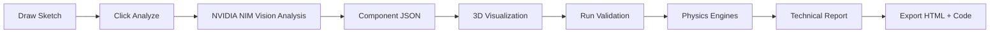
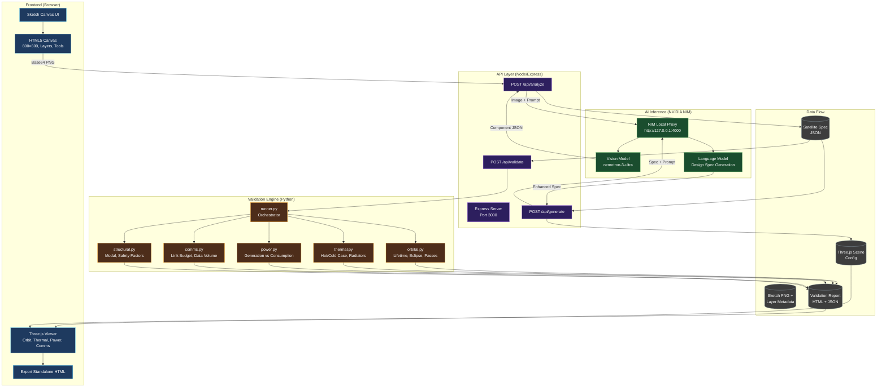
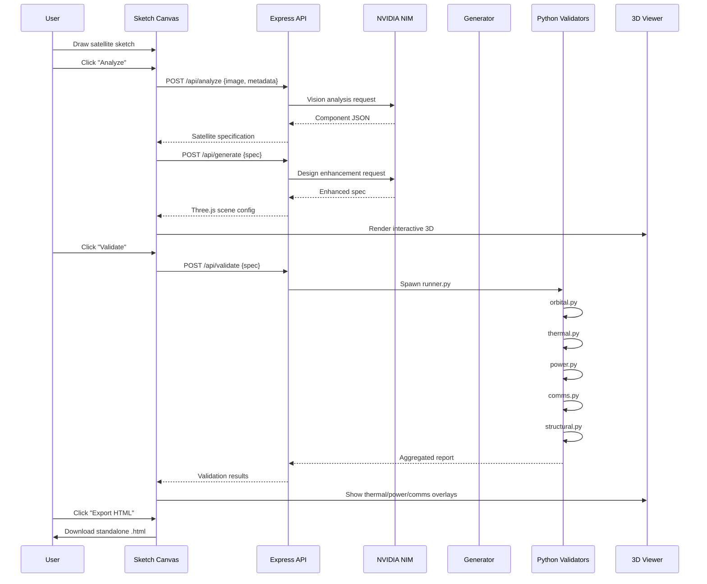
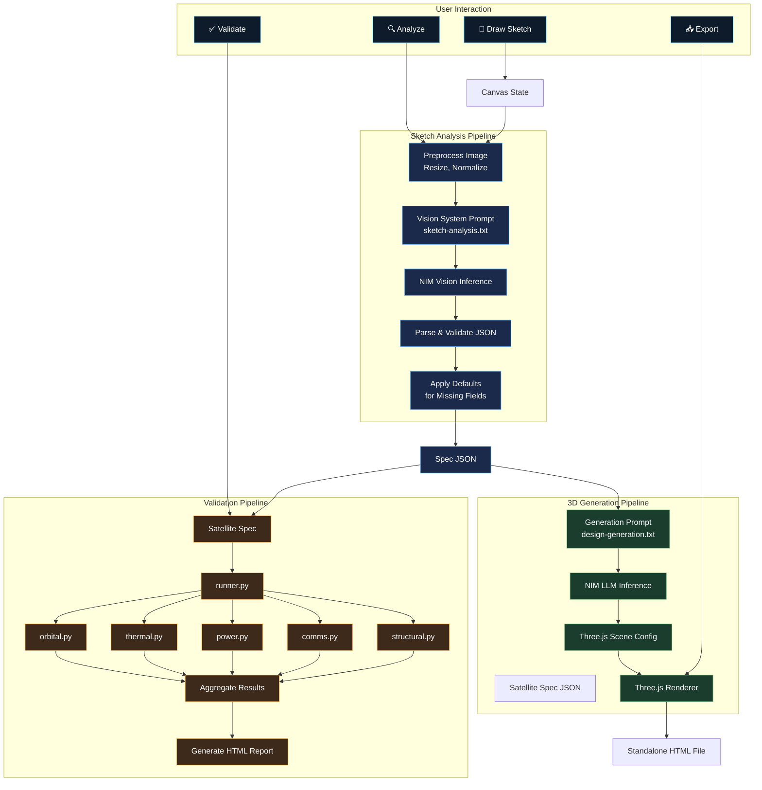

# NASA Space Apps Challenge - AI-Filtered Satellite Design Validator

## Project Overview
**Name:** StellarForge AI  
**Tagline:** "From Sketch to Space - AI-Validated Satellite Designs"  
**Challenge:** NASA Space Apps Challenge 2024/2025  
**Core Problem:** Space engineers and enthusiasts struggle to validate satellite design concepts early. Hand-drawn sketches lack technical validation, leading to costly redesigns later.

## Solution Architecture

### Core Concept
A **web-based AI-powered pipeline** that:
1. **Accepts** hand-drawn 2D satellite sketches (canvas upload or direct drawing)
2. **Analyzes** sketches using NVIDIA NIM-powered vision models (via local proxy)
3. **Generates** interactive HTML5/Three.js satellite visualizations
4. **Validates** designs against orbital mechanics, power budgets, thermal constraints, communication links
5. **Outputs** technical reports + runnable simulation code

---

## Technical Stack

| Layer | Technology | Purpose |
|-------|------------|---------|
| **Frontend** | Vanilla HTML5 + Canvas API + Three.js (ESM) | Sketch capture, 3D visualization |
| **AI Inference** | NVIDIA NIM (local proxy `http://127.0.0.1:4000`) | Vision analysis, design validation |
| **Backend** | Node.js + Express (lightweight) | API proxy, file serving |
| **Validation Engine** | Python (embedded via child_process) | Orbital mechanics, thermal, power calculations |
| **Build/Launch** | Batch/PowerShell scripts | One-click startup |

---

## Project Structure

```
nas-launcher/
├── PLAN.md                    # This file
├── package.json               # Dependencies
├── launch.bat                 # Windows one-click launcher
├── launch.sh                  # Linux/Mac launcher
├── .env.example               # Environment template
├── public/
│   ├── index.html             # Main SPA entry
│   ├── styles.css             # Styling
│   ├── app.js                 # Main application logic
│   ├── sketch-canvas.js       # Drawing canvas component
│   ├── three-renderer.js      # Three.js satellite renderer
│   ├── validation-panel.js    # Results display
│   └── assets/
│       └── satellites/        # Reference models
├── server/
│   ├── index.js               # Express server
│   ├── routes/
│   │   ├── analyze.js         # POST /api/analyze - sketch → JSON
│   │   ├── generate.js        # POST /api/generate - JSON → HTML/3D
│   │   └── validate.js        # POST /api/validate - design → report
│   └── nim-client.js          # NVIDIA NIM API client
├── validation/
│   ├── orbital.py             # Orbital mechanics calculator
│   ├── thermal.py             # Thermal analysis
│   ├── power.py               # Power budget calculator
│   ├── comms.py               # Link budget calculator
│   ├── structural.py          # Structural validation
│   └── runner.py              # Orchestrates all validators
├── prompts/
│   ├── sketch-analysis.txt    # System prompt for sketch → components
│   ├── design-generation.txt  # Prompt for 3D model generation
│   └── validation-criteria.txt # Validation rules
└── tests/
    └── integration.test.js
```

---

## Detailed Feature Specifications

### 1. Sketch Capture Interface (`public/sketch-canvas.js`)
- **Canvas**: 800x600px, pressure-sensitive (if tablet)
- **Tools**: Pen, eraser, shape primitives (rect, circle, solar panel, antenna)
- **Layers**: Structure, Power, Comms, Thermal, Payload
- **Export**: PNG + JSON metadata (strokes, colors, layer tags)
- **Shortcuts**: `Ctrl+Z` undo, `Ctrl+S` save, `Enter` analyze

### 2. AI Sketch Analysis (`server/routes/analyze.js` + `prompts/sketch-analysis.txt`)
**Input**: Base64 PNG + layer metadata  
**NVIDIA NIM Model**: `nvidia/nemotron-3-ultra` or vision model via NIM  
**Output JSON Schema**:
```json
{
  "satellite": {
    "bus": { "type": "cubesat|smallsat|espaclass", "dimensions": [x,y,z], "mass_kg": 50 },
    "power": { "solar_panels": [{ "area_m2": 0.5, "efficiency": 0.3, "deployable": true }], "battery_wh": 100 },
    "comms": { "antennas": [{ "type": "patch|dish|helical", "gain_dbi": 15, "frequency_ghz": 2.4 }], "ground_stations": [] },
    "thermal": { "radiators": [{ "area_m2": 0.2, "emissivity": 0.85 }], "ml_layers": 10 },
    "payload": { "instruments": [{ "name": "camera", "power_w": 10, "data_rate_mbps": 50 }] },
    "orbit": { "altitude_km": 550, "inclination_deg": 97.4, "eccentricity": 0.001 }
  },
  "confidence": 0.87,
  "warnings": ["Solar panel area may be insufficient for payload"]
}
```

### 3. 3D Model Generation (`server/routes/generate.js` + `public/three-renderer.js`)
- **Input**: Validated JSON from analysis
- **Output**: Interactive Three.js scene embedded in HTML
- **Features**:
  - Exploded view toggle
  - Orbital animation (real-time or accelerated)
  - Thermal visualization (heat map overlay)
  - Power flow diagram
  - Communication link visualization
  - Export: Standalone HTML file (self-contained, no external deps)

### 4. Design Validation Engine (`validation/*.py`)

| Validator | Checks | Output |
|-----------|--------|--------|
| **Orbital** | Lifetime, eclipse duration, ground track, delta-v budget | `orbital_report.json` |
| **Thermal** | Hot/cold case temps, radiator sizing, heater power | `thermal_report.json` |
| **Power** | Orbit-average generation vs consumption, battery depth-of-discharge | `power_report.json` |
| **Comms** | Link budget (Eb/N0), data volume per pass, contact time | `comms_report.json` |
| **Structural** | Launch loads (qualification), modal frequencies, safety factors | `structural_report.json` |

**Aggregated Report**: `validation_report.html` + `validation_summary.json`

### 5. NVIDIA NIM Integration (`server/nim-client.js`)
```javascript
// Local proxy configuration
const NIM_BASE_URL = 'http://127.0.0.1:4000/v1';
const MODEL = 'nvidia/nemotron-3-ultra'; // or vision model
// API key from .env: NVIDIA_API_KEY
```

---

## User Workflow



---

## System Architecture Flowchart



---

## Detailed Data Pipeline



---

## Component Interaction Diagram



---

## Validation Rules (from `prompts/validation-criteria.txt`)

### Power Budget
- [ ] Orbit-average solar generation > 1.3x average consumption
- [ ] Battery survives longest eclipse (max 35 min LEO)
- [ ] Depth of discharge < 80%

### Thermal
- [ ] All components within operating range (-20°C to +50°C typical)
- [ ] Radiator area sufficient for max dissipation
- [ ] Heater power budgeted for cold case

### Communications
- [ ] Link margin > 6 dB for telemetry
- [ ] Link margin > 3 dB for payload data
- [ ] Contact time supports data volume

### Orbital
- [ ] Lifetime > mission duration (drag, radiation)
- [ ] Eclipse fraction < 0.4 for power-positive
- [ ] Ground station access > 2 passes/day

### Structural
- [ ] First modal frequency > 50 Hz (launch vehicle req)
- [ ] Safety factor > 1.5 yield, > 2.0 ultimate
- [ ] CG within launcher envelope

---

## Deliverables for Prototype

### Minimum Viable Prototype (Week 1)
- [ ] `launch.bat` - starts server + opens browser
- [ ] `public/index.html` - sketch canvas + analyze button
- | `server/index.js` - Express + NIM proxy
- [ ] `server/nim-client.js` - NIM API wrapper
- [ ] `prompts/sketch-analysis.txt` - system prompt
- [ ] Mock validation (Python stubs returning sample data)

### Full Prototype (Week 2)
- [ ] Three.js renderer with satellite model
- [ ] Python validation engines (orbital, thermal, power, comms)
- [ ] Aggregated HTML report generator
- [ ] Export standalone HTML file
- [ ] Polish UI/UX

---

## Environment Configuration (`.env`)

```env
NVIDIA_API_KEY=your_nim_api_key_here
NIM_BASE_URL=http://127.0.0.1:4000/v1
NIM_MODEL=nvidia/nemotron-3-ultra
PORT=3000
PYTHON_PATH=python
```

---

## Launch Commands

**Windows:**
```bat
launch.bat
```

**Linux/Mac:**
```bash
chmod +x launch.sh && ./launch.sh
```

**Manual:**
```bash
npm install
npm start
# Opens http://localhost:3000
```

---

## Success Criteria for NASA Space Apps

1. **Innovation**: First sketch-to-validated-satellite pipeline using local AI
2. **Impact**: Reduces early-phase design iteration from weeks → minutes
3. **Technical**: Runs fully offline (except NIM model weights), no cloud dependency
4. **Usability**: Non-experts can validate concepts; experts get technical reports
5. **Extensibility**: Modular validators for adding new physics domains

---

## Risk Mitigation

| Risk | Mitigation |
|------|------------|
| NIM model unavailable | Fallback to rule-based component detection |
| Python not installed | Bundle validation as Node.js (wasm) or ship portable Python |
| Complex sketches fail | Layer tagging + shape primitives guide user |
| Validation too slow | Cache results, async processing, progress UI |

---

## Next Steps

1. **Initialize** `package.json` with dependencies
2. **Create** `launch.bat` / `launch.sh`
3. **Build** Express server + NIM client
4. **Implement** sketch canvas + analysis flow
5. **Integrate** Three.js renderer
6. **Develop** Python validation modules
7. **Test** end-to-end with sample sketches
8. **Polish** for demo

---

*Generated for NASA Space Apps Challenge - StellarForge AI Team*